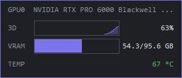
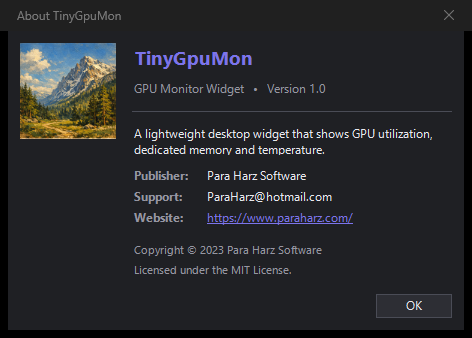

# TinyGpuMon

**A tiny, lightweight GPU monitor for your Windows desktop.**

The three numbers you keep checking in Task Manager → Performance → GPU —
**3D utilization, dedicated VRAM, temperature** — on one small card that stays out of your way.

**Download:** [`TinyGpuMon-1.0-win-x64.zip`](https://github.com/ParaHarz/TinyGpuMon/releases/download/v1.0/TinyGpuMon-1.0-win-x64.zip) — free, a single .exe, nothing to install.

SHA-256: `D21F74E833E49B9B0E4C4CFFF5BC95C246F8CD0E83E13711B4C47E17B1BC6B99`

---

## What it shows

- **3D** — GPU utilization, with a rolling ~1-minute sparkline
- **VRAM** — dedicated memory, used / total, with a filled bar
- **TEMP** — GPU temperature, color-coded: green < 70° · yellow < 85° · red ≥ 85°

## Features

- **Tray resident** — no taskbar button; double-click the tray icon to show / hide the card
- **Always on top** — toggle from the menu (double-clicking the card also toggles it; purple border = on)
- **Draggable** — grab the card and move it anywhere on the desktop
- **Multi-GPU** — pick which device to watch from the menu
- **Start with Windows** — one click, per-user, no admin rights needed
- **Single instance** — launching again just tells you it's already running
- **Zero dependencies** — uses your NVIDIA driver's own `nvml.dll`; nothing else to install

## Requirements

- Windows 10 or 11 (64-bit)
- An NVIDIA GPU with a current driver
- .NET Framework 4.8 — included with Windows 10/11, nothing to install

## Quick start

1. Download the zip and extract it anywhere you like (e.g. `C:\Tools\TinyGpuMon`)
2. Run `TinyGpuMon.exe` — the card appears at the top-left of the screen
3. Drag it to your favorite spot; right-click the card (or the tray icon) for options
4. Optional: enable **Start with Windows** in the menu

| Action | Effect |
| --- | --- |
| Left-drag the card | Move it anywhere on the desktop |
| Right-click the card / tray icon | Open the menu |
| Double-click the card | Toggle "Always on top" |
| Double-click the tray icon | Show / hide the card |

Menu: **Always on top** · **Start with Windows** · GPU selection (multi-GPU systems) · **About** · **Exit**.
The card samples the GPU once per second.

## About the dialog

## Publisher

| | |
| --- | --- |
| Publisher | Para Harz Software |
| Website | https://www.paraharz.com/ |
| Support | ParaHarz@hotmail.com |
| Copyright | © 2023 Para Harz Software |

## License

[MIT](LICENSE) © 2023 Para Harz Software
